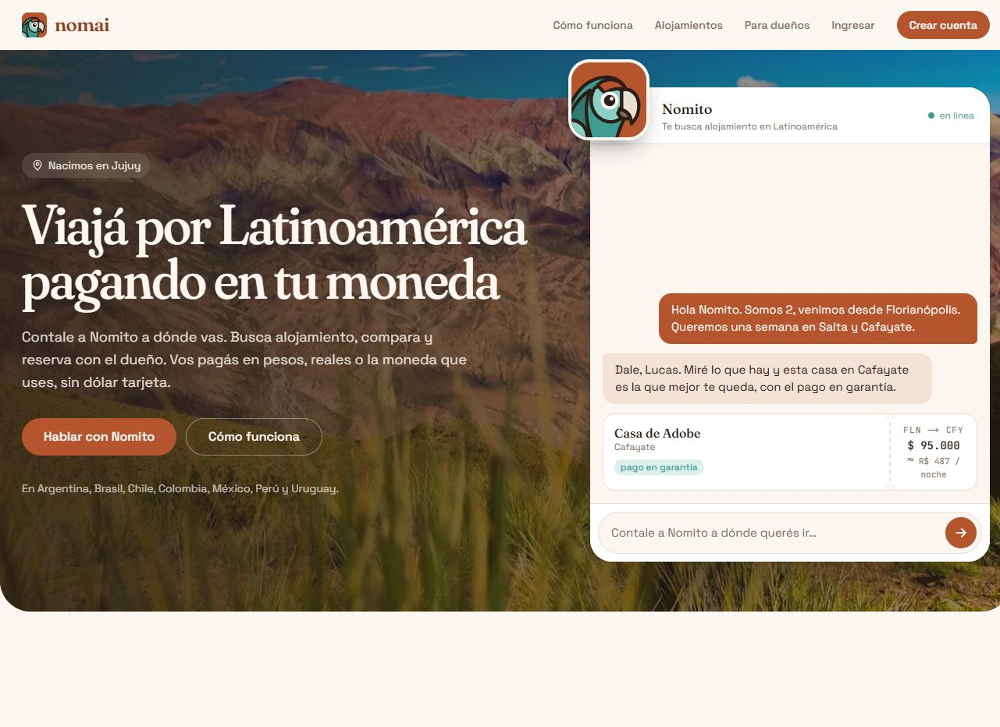
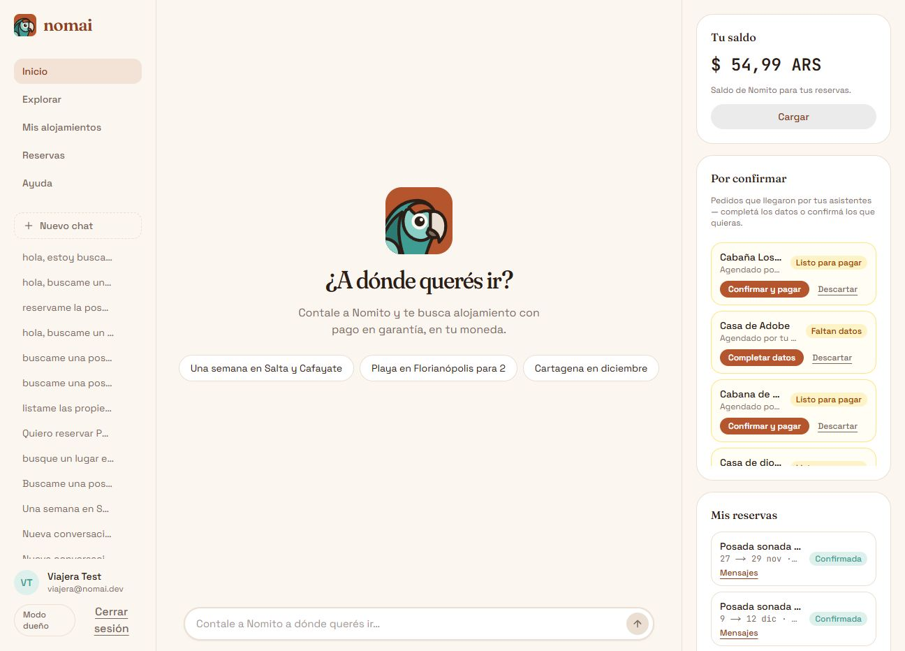
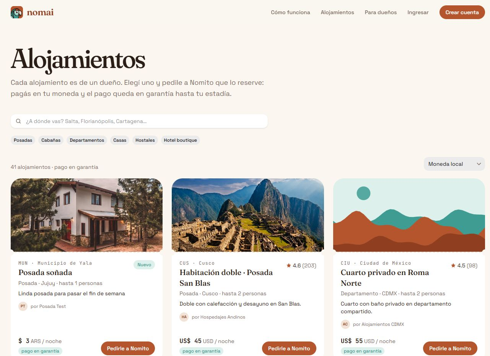
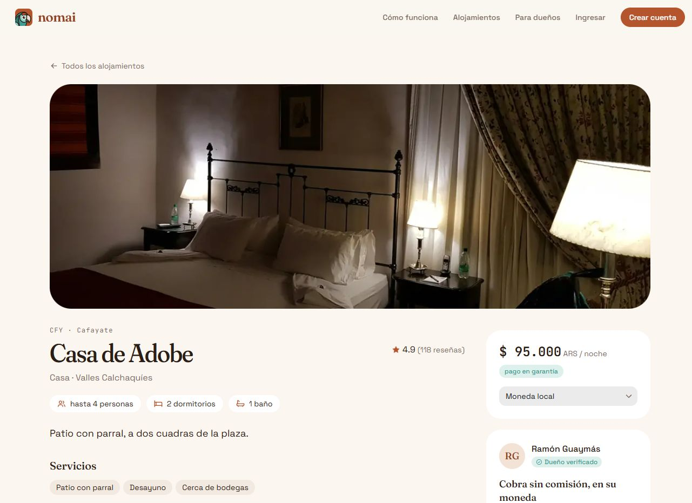

<div align="center">


# Nomai

**Travel across Latin America paying in your own currency.**

An AI travel agent that searches, books and pays in local stablecoins on Celo —
with the money held in escrow until the stay happens.

[Live demo](https://nomaiapp.vercel.app) ·
[API](https://nomai-api.vercel.app) ·
[Agent identity](https://nomaiapp.vercel.app/.well-known/agent.json) ·
[ADRs](docs/adr)

</div>

---

## The problem

Booking a stay in Latin America usually means paying in dollars through an OTA
that keeps 15–18% of the rental. The Traveler pays more, the Owner earns less,
and the money crosses a currency border before it ever reaches the person who
rented the house. Cross-border prepayments add the trust problem on top: someone
has to send money first.

Nomai removes the OTA and the dollar leg. A Traveler talks to **Nomito**, the
Agent, in plain Spanish; Nomito searches, quotes in the local currency and pays
the Booking with **wARS** (or another Ripio wFIAT) over **x402 on Celo mainnet**.
The rental amount goes into a shared **Escrow** vault, not to the Owner, and is
released in two stages around the stay. Owners are never charged: no
subscription, no commission.

## What works today

- **Marketplace** — published Lodgings with photos, availability, prices in the
  local currency, reviews and an Owner storefront (`/lodgings`, `/owners/[slug]`).
- **Agent chat** — Nomito on [`eve`](https://eve.dev) + `assistant-ui`, with tools
  for search, quote, booking, cancellation, reviews, claims and wallet balance.
- **Traveler-pays Bookings** — the API answers `402 Payment Required`; the Agent
  asks the API to sign that payment with the **Traveler's own custodial wallet**
  and retries. Funds settle into the Escrow vault, not to the Owner.
- **Escrow lifecycle** — 50% releases at the Cancellation deadline (5 days before
  check-in), the rest 24 h after check-in if there is no Claim. Cancellation
  refunds 100% before the deadline, 50% after; the Service fee is never refunded.
  A keeper runs the releases and the refunds on-chain.
- **Owner panel** — Lodging CRUD, night blocking, Booking threads, Ripio payout
  address verification and the Escrow release timeline.
- **MCP server** — `POST /mcp` with OAuth 2.1 / Supabase Bearer, so any MCP client
  can search, quote, create Booking requests and read a Booking thread.
- **Agent identity** — ERC-8004 identity `10049` on Celo mainnet, served at
  `/.well-known/agent.json`.

### Screenshots

<div align="center">







</div>

## How a Booking works

1. The Traveler asks Nomito for a place, dates and guests.
2. Nomito runs a fresh `quote_booking`: rental + Service fee (7% by default),
   displayed in the Lodging's currency.
3. On explicit confirmation, `book_listing` POSTs to
   `/listings/:slug/book`. The API re-checks availability and answers `402` with
   the exact wFIAT amount and the Escrow vault as `payTo`.
4. The Agent sends those requirements to `POST /wallet/:id/payment-auth`. The API
   signs with the Traveler's custodial key — only for an accepted wFIAT, only to
   the configured Escrow, and only if the balance covers it.
5. The paid retry settles on-chain. The Booking is confirmed only when the
   `PAYMENT-RESPONSE` receipt carries a transaction hash.
6. At the Cancellation deadline the vault releases 50% to the Owner; 24 h after
   check-in it releases the rest, unless a Claim is open.

## Why Celo

| Rail | What Nomai uses |
| --- | --- |
| **wFIAT** | wARS as the unit of account and settlement. The same pattern covers wBRL, wMXN, wCOP, wPEN and wCLP. |
| **x402** | The seller answers `402` on the Booking route and settles through Celo's hosted facilitator. |
| **Gas** | The Traveler never needs CELO: the facilitator sponsors gas, the Agent wallet only holds wFIAT. |
| **ERC-8004** | One project identity on Celo mainnet, discoverable through `agent.json`. |
| **Attribution** | Every project transaction carries the event's ERC-8021 tag. |
| **Escrow** | A minimal Solidity vault (`apps/api/contracts/Escrow.sol`) holds each Booking's rental until release or refund. |

## Live on Celo mainnet

| | |
| --- | --- |
| Demo | <https://nomaiapp.vercel.app> |
| API | <https://nomai-api.vercel.app> |
| Agent wallet | `0x8BCF810436f39cb386d0137B738a516F44d8731C` |
| ERC-8004 `agentId` | `10049` — registry `0x8004A169FB4a3325136EB29fA0ceB6D2e539a432` |
| Identity tx | [`0x2ed0…3e50`](https://celoscan.io/tx/0x2ed0d353dc365a64c024f24ec88dd82b639c0332dce6dcb1918abc36faf13e50) |
| Attribution tag | `celo_40fb48026a9f` |
| wARS | `0x0DC4F92879B7670e5f4e4e6e3c801D229129D90D` |
| Escrow vault | [`0x59E4…b07d`](https://celoscan.io/address/0x59E45048ec1415766236AF449a6160e644F8b07d) on Celo mainnet (chain 42220) |
| Agent document | <https://nomaiapp.vercel.app/.well-known/agent.json> |

Production runs with `X402_NETWORK=mainnet`, `X402_ASSETS=wars` and
`LISTINGS_DATA_SOURCE=supabase`.

### Verified mainnet activity (2026-11-08)

A real Booking end to end, all on Celo mainnet:

| Step | Evidence |
| --- | --- |
| Booking | `bkg_e338575f62294f59a1387e6e37342ef0` — 2 nights, ARS 2.14, status `confirmed` |
| wARS deposit | [`0xea71…64ec`](https://celoscan.io/tx/0xea71da72b4e78ed8cf00a199692fd3e179c70373279166a521c1ece48c8c64ec) — 2.14 wARS from the Traveler's Agent wallet `0xD404…F1E5` to the Escrow |
| Escrow release | [`0xfe8b…b521`](https://celoscan.io/tx/0xfe8b345856e1bd7586347fd0483b25d04644826722ff8ffc5c957cc5362fb521) — 1.00 wARS from the Escrow to the Owner `0x0779…1924`, tagged `celo_40fb48026a9f` |
| ERC-8004 mint | [`0x2ed0…3e50`](https://celoscan.io/tx/0x2ed0d353dc365a64c024f24ec88dd82b639c0332dce6dcb1918abc36faf13e50) — tagged |

The x402 settlement is submitted by Celo's facilitator, so its calldata does
not carry Nomai's attribution tag. The transactions Nomai sends itself — the
Escrow release above, the keeper, the payouts and the ERC-8004 mint — do. The
deposit is still fully verifiable on-chain: a wARS `Transfer` from the
Traveler's wallet to the Escrow vault.

Want to try it? The login page lists the seeded demo accounts:

| Role | Email | Password |
| --- | --- | --- |
| Traveler | `viajera@nomai.dev` | `nomai123` |
| Owner | `duena@nomai.dev` | `nomai123` |

## Repository layout

| Path | What lives there |
| --- | --- |
| `apps/web` | Next.js 15 (App Router), React 19, Tailwind 4, HeroUI v3. Traveler + Owner UI, the Agent chat, the MCP/OAuth proxy and `/.well-known/agent.json`. |
| `apps/api` | Hono server. x402 seller on `POST /listings/:slug/book`, MCP server, Owner write surface, payout verification, Escrow vault + keeper, payout/release scripts. |
| `apps/agent` | Nomito, an [`eve`](https://eve.dev) app. Tools for search, quote, `book_listing` (pays from the Traveler's wallet via `payment-auth`), cancellation, reviews, claims, `check_wallet`. |
| `supabase` | Postgres migrations, RLS and the generated seed. |

## Run locally

Requirements: Node >= 18 for web/api, **Node >= 24 for the Agent**, pnpm 8.

```bash
pnpm install
cp apps/api/.env.template apps/api/.env
cp apps/agent/.env.example apps/agent/.env
pnpm dev            # api :3001 + web :3000 (the web spawns the eve dev server)
```

Key environment variables for `apps/api`: `X402_NETWORK` (`mainnet` or `testnet`),
`X402_ASSETS` (e.g. `wars`), `X402_API_KEY`, `ESCROW_ADDRESS`,
`AGENT_WALLET_MASTER_SECRET`, `SUPABASE_URL`, `SUPABASE_SECRET_KEY` and
`OPS_WALLET_PRIVATE_KEY` for the keeper. See `apps/api/.env.template` and
`docs/supabase/`.

> `X402_ASSETS` must exist on the selected network: wFIAT tokens are mainnet
> only. A mismatch (e.g. `X402_ASSETS=wars` with `X402_NETWORK` unset, which
> defaults to testnet) throws on import and fails every request.

### Useful commands

```bash
pnpm api:dev                 # api only
pnpm agent:dev               # eve agent TUI
pnpm build                   # turbo build
pnpm lint                    # turbo lint
pnpm type-check              # turbo type-check
pnpm --filter web test       # vitest
pnpm --filter web test:e2e   # Playwright (needs the api on :3001)

pnpm --filter api smoke:escrow   # Escrow vault on in-process ganache
pnpm --filter api smoke:keeper   # keeper matrix on ganache
pnpm --filter api smoke:payout   # Owner payout flow on ganache
pnpm --filter agent smoke:book   # Traveler-pays Booking loop (dry-run by default)
pnpm --filter agent erc8004      # ERC-8004 register / check
```

## Documentation

- [`GLOSSARY.md`](GLOSSARY.md) — Traveler, Owner, Agent, Booking, Service fee,
  Escrow, Claim, FX fee.
- [`docs/adr/`](docs/adr) — the decisions: business model, abuse controls,
  per-Traveler wallets, cancellation, Service fee, Escrow, reviews, messaging,
  Booking requests over MCP.
- [`docs/mcp.md`](docs/mcp.md) — MCP server, OAuth 2.1 and the Booking threads.
- [`X402_SETUP.md`](X402_SETUP.md) — the x402 payment flow and facilitator setup.
- [`docs/erc8004-registration.md`](docs/erc8004-registration.md) — the agent
  identity, the registry and the attribution tag.
- [`docs/supabase/`](docs/supabase) — environment, schema/RLS and CLI workflows.
- [`docs/design/`](docs/design) — the Traveler and Owner view specs.
- [`docs/negocio/`](docs/negocio) — user stories and the business case.

## Hackathon

**Agents on Open Rails Hackathon — track: Stable Agents: LatAm
(Ripio × Celo Core Co.).**

Nomai is a wFIAT agent with real money moving on Celo mainnet. Against the
track's five criteria:

| Criterion | How Nomai answers it |
| --- | --- |
| **Works on mainnet with a real wFIAT token** (20%) | Bookings settle in wARS on Celo mainnet, through the Escrow vault. The demo and the ERC-8004 identity are live; the identity tx carries the event's attribution tag. |
| **Real use of wFIAT and the Celo stack** (20%) | wARS is the unit of account and the settlement asset. x402 prices the Booking, the facilitator sponsors gas, ERC-8004 gives the Agent a verifiable identity, ERC-8021 tags the project's transactions. |
| **Agent autonomy and usefulness** (20%) | Nomito searches, quotes, checks availability, books and pays on its own. Guardrails: a signed-in Traveler is required, the quote must be fresh, the total needs explicit confirmation, the wallet balance is the hard cap, `payTo` is locked to the Escrow, and only configured wFIAT assets can be signed. |
| **UX a real person can use** (20%) | The Traveler just talks. Prices are in the local currency, there is no seed phrase, no gas token and no crypto vocabulary; "pago en garantía" explains the Escrow in one line. |
| **Impact for LatAm** (20%) | Owners keep the full rental (no commission, no subscription); Travelers pay in the currency they earn in; the same rails extend to Brazil, Mexico, Colombia, Chile and Peru. |

**Roadmap after the hackathon:** more wFIAT corridors (wBRL, wMXN, wCOP, wPEN,
wCLP), FX conversion between wFIAT, Self proof-of-human for the funding tiers,
and a public Owner onboarding funnel.
